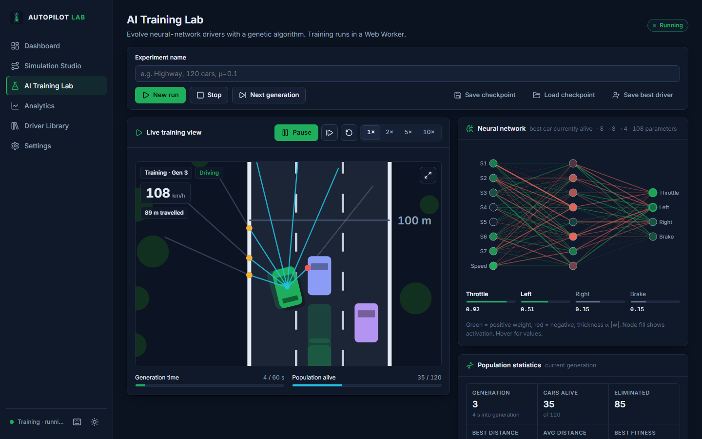
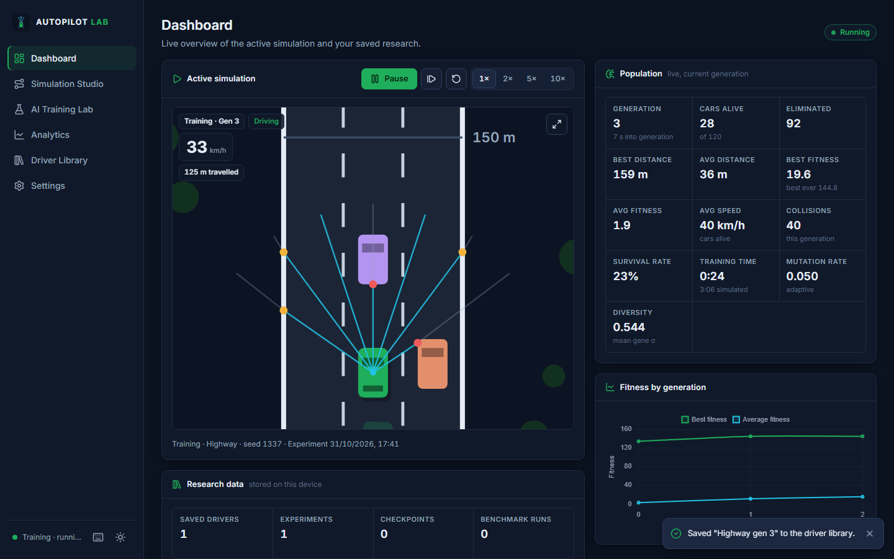
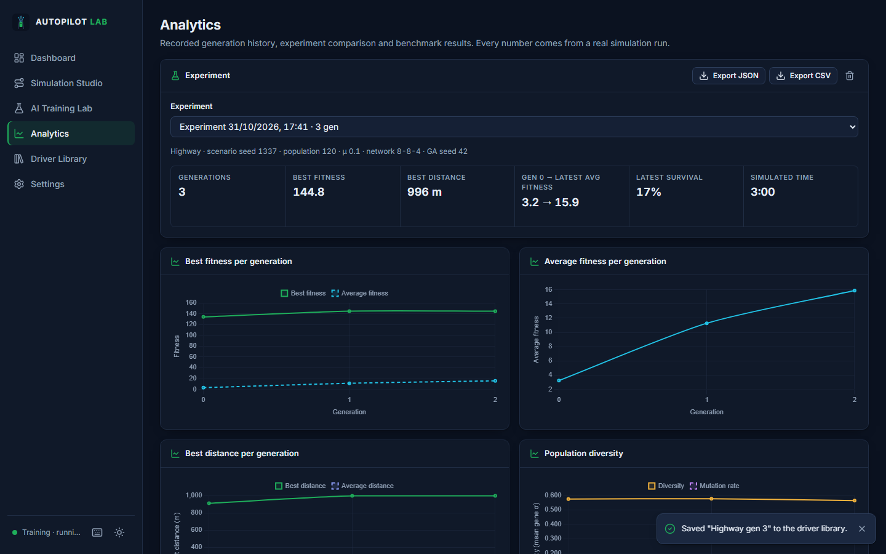
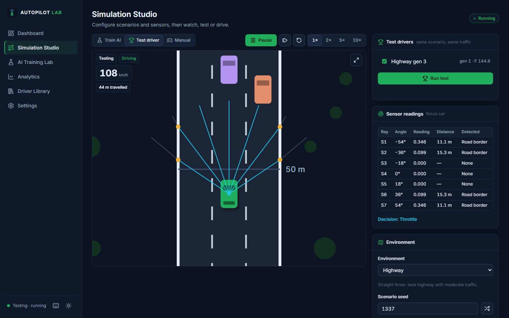
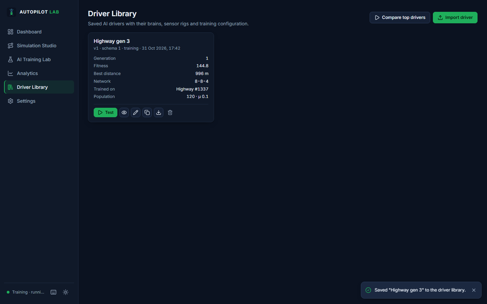
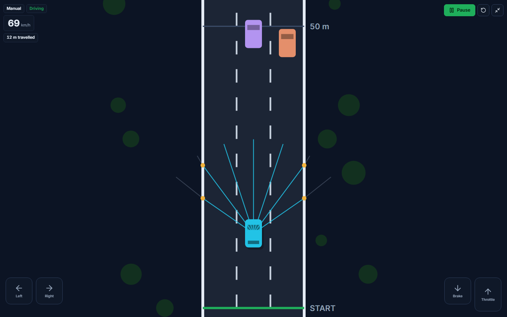
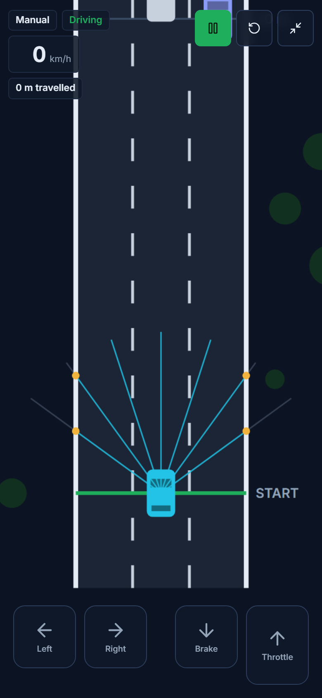
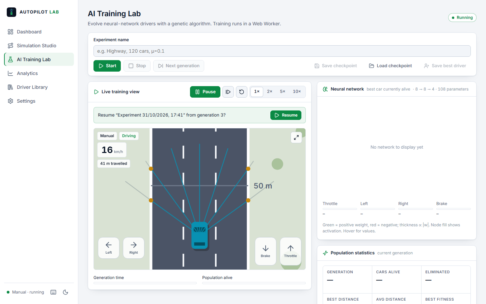

# Autopilot Lab

[](https://github.com/hammaddola/autopilot-lab/actions/workflows/ci.yml)

**An autonomous-driving AI simulation and research platform that runs entirely in the browser.**
Evolve neural-network drivers with a genetic algorithm, test them on repeatable scenarios, compare
experiments, and take the wheel yourself — on desktop or phone, online or offline.

> **Simulation ≠ reality.** Autopilot Lab is an educational and experimental simulator. A driver that
> performs well here has learned to exploit a simplified 2-D world with perfect ray sensors and
> scripted traffic. Nothing here says anything about real-world autonomous-driving safety.



## Contents

[Features](#features) · [Screenshots](#screenshots) · [Keyboard shortcuts](#keyboard-shortcuts) ·
[Tech stack](#technology-stack) · [Architecture](#architecture) · [Folder structure](#folder-structure) ·
[Installation](#installation) · [Development](#development-commands) ·
[Production build](#production-build) · [Testing](#testing) · [The AI](#the-neural-network) ·
[Genetic algorithm](#the-genetic-algorithm) · [Physics](#physics) · [Data storage](#data-storage) ·
[PWA](#pwa--offline) · [CI](#continuous-integration) · [GitHub Pages](#deploy-to-github-pages) ·
[Netlify](#deploy-to-netlify) · [Benchmark results](#training-benchmark-results) ·
[Known limitations](#known-limitations) · [Roadmap](#roadmap)

## Features

| Area                  | What you get                                                                                                                                                                                                                                                                                                                                          |
| --------------------- | ----------------------------------------------------------------------------------------------------------------------------------------------------------------------------------------------------------------------------------------------------------------------------------------------------------------------------------------------------- |
| **Simulation**        | Top-down Canvas 2D world, fixed 60 Hz timestep, 1×/2×/5×/10× speed, pause/resume/step/restart. Seeded roads (straight, curved, urban bends) with configurable lanes (2–6) and lane width, dashed markings, borders, 50 m distance markers, smooth look-ahead camera, procedural scenery.                                                              |
| **Vehicle physics**   | Acceleration, braking, reverse, rolling friction, speed-dependent steering, top speed, momentum; polygon (oriented rectangle) collision against road borders, traffic and obstacles.                                                                                                                                                                  |
| **Traffic**           | Deterministic seeded traffic (cars, trucks, barriers), lane-dependent speeds, three patterns (random, staggered, platoons), density control, never a fully blocked row, lazy spawn/cleanup.                                                                                                                                                           |
| **Six environments**  | Highway · Urban streets · Curved highway · Obstacle course · Dense traffic · Challenge mode — every parameter (seed, density, speed, lanes, width, obstacles, pattern) adjustable.                                                                                                                                                                    |
| **Sensors**           | 1–16 rays (default 7), 50–500 range (default 170), 10–300° field of view (default 108°). Live debug view (origin, rays, hit points coloured by object type) and a per-ray table: angle, normalised reading, distance, detected object.                                                                                                                |
| **Neural network**    | From-scratch feed-forward net, configurable hidden layers (1–3 × 1–32), tanh hidden / sigmoid outputs, reproducible init, validated (de)serialisation. Live visualisation: weights coloured by sign, width by magnitude, node activation, hover tooltips, live output bars and current decision.                                                      |
| **Genetic algorithm** | Population 10–400 (default 120), best-ever preservation, elitism, tournament selection, uniform crossover, Gaussian mutation (rate 0–0.5), adaptive mutation driven by measured diversity and stagnation, configurable weighted fitness, crash and stall elimination, auto-advancing generations. Runs in a Web Worker.                               |
| **Modes**             | **Train AI** · **Test drivers** (one or several saved drivers on the same scenario, follow any of them, results recorded as benchmarks) · **Manual driving** (arrows/WASD or on-screen touch pedals, collision feedback, opens in full-screen drive mode).                                                                                            |
| **Analytics**         | Live dashboard (generation, alive, eliminated, best/avg distance, best/avg fitness, avg speed, collisions, survival, training time, mutation rate, diversity). Six Chart.js charts with axis titles and tooltips, experiment comparison overlay + config table, benchmark history, CSV/JSON export. Empty states everywhere — no placeholder numbers. |
| **Driver library**    | Save, name, describe, version, preview network, test, duplicate, delete (confirmed), export/import JSON with schema version and strict validation.                                                                                                                                                                                                    |
| **Persistence**       | IndexedDB (drivers, experiments with full generation history, checkpoints, benchmarks), versioned with migrations; auto + manual checkpoints; resume after reload; backup export/import; corrupt-record detection and repair.                                                                                                                         |
| **Performance**       | Worker simulation, transferable typed-array frames, render/sim decoupling, Low/Balanced/High/Auto quality, optional overlay with FPS, sim steps/s, worker ms, render ms, active vehicles.                                                                                                                                                             |
| **PWA**               | Installable (manifest + icons + install button), offline after first load, versioned cache with cleanup, user-controlled update prompt, offline fallback page.                                                                                                                                                                                        |
| **UI**                | Dark and light themes, responsive desktop/tablet/mobile layouts (bottom navigation on phones), Lucide icons, Inter, keyboard accessible, reduced-motion support.                                                                                                                                                                                      |

## Screenshots

All screenshots are of real runs (`scripts/screenshots.ts` starts training and captures the app; nothing is staged).

| Dashboard                                         | Analytics                                                                              |
| ------------------------------------------------- | -------------------------------------------------------------------------------------- |
|       |                                            |
| **Simulation Studio — testing a saved driver**    | **Driver Library**                                                                     |
|        |                                         |
| **Drive mode — manual driving fills the screen**  | **Mobile — drive mode with touch pedals**                                              |
|  |  |
| **Light theme**                                   |                                                                                        |
|  |                                                                                        |

## Keyboard shortcuts

Press <kbd>?</kbd> anywhere (or the keyboard icon in the sidebar) for the in-app list.

| Keys                                                         | Action                                 |
| ------------------------------------------------------------ | -------------------------------------- |
| <kbd>Space</kbd>                                             | Pause / resume                         |
| <kbd>N</kbd>                                                 | Step one frame while paused            |
| <kbd>R</kbd>                                                 | Restart the run (manual and test mode) |
| <kbd>1</kbd> – <kbd>4</kbd>                                  | Speed 1× / 2× / 5× / 10×               |
| <kbd>F</kbd> / <kbd>Esc</kbd>                                | Enter / leave full-screen drive mode   |
| <kbd>W</kbd> <kbd>A</kbd> <kbd>S</kbd> <kbd>D</kbd> / arrows | Drive (manual mode)                    |

Training restarts are deliberately not bound to a key — they go through the confirm dialog.

## Technology stack

TypeScript (strict) · Vite 6 · HTML5 · modern CSS (custom properties, no framework) · Canvas 2D ·
Web Workers · IndexedDB · Chart.js 4 · Lucide · Inter (self-hosted via Fontsource, works offline) ·
Vitest 3 + fake-indexeddb · Playwright · ESLint 9 + typescript-eslint · Prettier.

Runtime dependencies are deliberately limited to **chart.js**, **lucide** and the **Inter** font.
No UI framework, no state library, no IndexedDB wrapper.

## Architecture

```
main thread                                     Web Worker
───────────                                     ──────────
ui/pages ─ ui/components ─ ui/render            workers/simulation.worker
        │                                         │  fixed-timestep loop, speed multiplier, time budget
        ▼                                         ▼
app/controller ── typed, validated messages ──► engine/session  (train | test | manual)
   │  frames (transferred Float32Arrays) ◄──────   ├─ ai/network · ai/genetic · ai/fitness
   ▼                                               └─ simulation/world · road · traffic · car · sensor
storage/db (IndexedDB) · app/preferences (LocalStorage)        core/rng · core/geometry
```

- The **simulation, AI and engine layers contain no DOM code**; the same `Session` runs in the worker, in
  unit tests and in the Node benchmark.
- All three modes run in the worker; the main thread only renders the latest snapshot with
  `requestAnimationFrame`. The road is rebuilt locally from its deterministic config, so only vehicle
  poses cross the boundary.
- Traffic positions are an analytic function of time and seed, which makes every scenario exactly
  repeatable — the basis for fair benchmarking.

Decisions and the reasoning behind them are recorded in **[docs/ARCHITECTURE.md](docs/ARCHITECTURE.md)**.

## Folder structure

```
├─ index.html                 app shell (CSP, manifest, icons)
├─ public/                    manifest.webmanifest, offline.html, icons/
├─ pwa/sw.template.js         service-worker template (precache list injected at build)
├─ src/
│  ├─ main.ts                 shell, navigation, theme, PWA init
│  ├─ core/                   rng.ts (seeded Mulberry32), geometry.ts (intersections, polygons)
│  ├─ simulation/             config.ts, road.ts, traffic.ts, car.ts (physics), sensor.ts, world.ts
│  ├─ ai/                     network.ts, genetic.ts, fitness.ts
│  ├─ engine/session.ts       train / test / manual orchestration, stats, checkpoints
│  ├─ workers/                protocol.ts (typed + validated messages), simulation.worker.ts
│  ├─ storage/                db.ts (IndexedDB, migrations, backups), validation.ts (all untrusted input)
│  ├─ app/                    controller.ts, router.ts, preferences.ts, pwa.ts, nav.ts
│  └─ ui/
│     ├─ components/          button, form (slider/select/toggle/fields), feedback (toast/dialog/status),
│     │                       layout (panel/stat/table/empty), chart, viewport, live
│     ├─ render/              renderer.ts (simulation canvas), networkView.ts
│     ├─ pages/               dashboard, studio, training, analytics, library, settings
│     └─ styles/main.css      design tokens, themes, responsive layout
├─ tests/unit/                Vitest
├─ tests/e2e/                 Playwright (desktop + Pixel 7)
├─ scripts/                   benchmark.ts, evaluate.ts, perf.ts, screenshots.ts, icons.ts
└─ docs/                      ARCHITECTURE.md, benchmark logs/JSON, screenshots
```

## Installation

Requirements: Node.js 20+ (developed on Node 24) and npm.

```bash
npm install
npx playwright install chromium   # only needed for browser tests / screenshots
```

## Development commands

| Command                                  | Does                                                                               |
| ---------------------------------------- | ---------------------------------------------------------------------------------- |
| `npm run dev`                            | Vite dev server with HMR at http://localhost:5173 (service worker disabled in dev) |
| `npm run typecheck`                      | `tsc --noEmit` (strict)                                                            |
| `npm run lint`                           | ESLint (flags `eval`, `new Function`, implied eval)                                |
| `npm run format` / `format:check`        | Prettier write / verify                                                            |
| `npm test`                               | Vitest unit tests                                                                  |
| `npm run test:e2e`                       | Builds, serves the production build on :4173 and runs Playwright                   |
| `npm run benchmark -- 25 highway 120 42` | Headless reproducible training benchmark (see below)                               |
| `npm run check`                          | typecheck + lint + format check + unit tests + build                               |

## Production build

```bash
npm run build      # type-checks, bundles to dist/, generates dist/sw.js with a versioned precache
npm run preview    # serve dist/ at http://localhost:4173
```

The build uses relative URLs (`base: './'`), so `dist/` works at a domain root or under a sub-path.

## Testing

- **Unit (Vitest, 44 tests)** — network forward pass (checked against a hand-computed value),
  serialisation round-trip and rejection of malformed brains, segment/polygon intersection, sensor
  distances and field of view, vehicle physics (acceleration, limit, momentum, braking → reverse,
  steering), tournament selection bias, crossover, mutation rate, diversity, adaptive mutation,
  best-ever preservation, fitness formula and safety gating, seeded determinism of whole training runs,
  traffic determinism and non-overlap across presets, never-blocked obstacle rows, checkpoint
  export/restore equivalence, config clamping, IndexedDB CRUD/no-overwrite/corrupt-record handling/auto
  checkpoint replacement/backup round-trip (fake-indexeddb), driver import validation (size, schema,
  shape, hostile strings), worker message validation.
- **End-to-end (Playwright, 8 tests)** — startup with zero console errors, navigation through all pages,
  manual driving with keyboard incl. crash banner and restart, AI training start/pause/resume/next
  generation, saving a driver, driver export → import (as a non-overwriting copy) and malformed-file
  rejection, testing a saved driver, checkpoint persistence across reload and resume, theme switching
  and persistence, seeded scenario application, PWA manifest + service worker + **offline reload**, and a
  Pixel 7 run checking bottom navigation, no horizontal overflow on any page and touch-pedal driving.

```bash
npm test
npm run test:e2e
```

## The neural network

Default architecture **8 → 8 → 4** (108 parameters).

- **Inputs**: seven ray readings `xᵢ = 1 − dᵢ/R` (0 = nothing within range, → 1 = touching) plus forward
  speed `v / v_max`.
- **Hidden**: `h = tanh(W₁x + b₁)`; **output**: `y = σ(W₂h + b₂)`.
- **Controls**: throttle if `y₀ > 0.5`; steer = `[y₂ > 0.5] − [y₁ > 0.5]` (right − left); brake if `y₃ > 0.5`
  (reverses once stopped).
- Weights are a flat `Float64Array` genome (per layer: weight matrix row-major, then biases), initialised
  uniformly in [−1, 1] from a seeded RNG. Non-finite inputs/activations are zeroed; imported genomes are
  length- and finiteness-checked.

Full derivation and how to extend it: [docs/ARCHITECTURE.md](docs/ARCHITECTURE.md#the-neural-network).

## The genetic algorithm

Each generation every driver runs the **same seeded scenario** until it crashes, stalls (no progress for
3 s), finishes, or reaches the time limit (60 s). Fitness:

```
F = w_d·D/100 + w_c·C + w_s·(S̄/v_max)·[no crash] + w_t·(T/T_ep) − w_col·[crash] − w_l·L
defaults: w_d=1  w_c=2  w_s=4  w_t=5  w_col=10  w_l=2
```

D = distance (units, 1 u = 0.1 m), C = 50 m checkpoints, S̄ = mean speed, T = time in episode,
L = mean normalised distance from lane centre. Speed only counts for drivers that did not crash.

Next generation: **slot 0 is always the unchanged best-ever genome**, then elites (top 5 %), then children:
tournament selection (k = 4) → uniform crossover (70 %) → Gaussian mutation (each gene with probability μ,
σ = 0.5). With **adaptive mutation**, μ is scaled by `0.25 / diversity` (clamped ×0.5…×2.5) and ×1.5 after five
generations without improvement, capped at 0.5. The GA RNG state is checkpointed, so resumed runs are
bit-identical to uninterrupted ones.

## Physics

Units: 1 unit = 0.1 m; timestep 1/60 s. Each step:

```
v += a_throttle·throttle·dt
v −= (v > 1 ? a_brake : ½·a_throttle)·brake·dt      // brake, or reverse once stopped
v  → 0 by friction·dt (never crosses zero)
v  = clamp(v, −v_reverse, v_max)
θ += steer·steerRate·min(1, |v|/60)·sign(v)·dt       // no turning on the spot; reversed when reversing
x += sin θ·v·dt ;  y −= cos θ·v·dt
```

Defaults: top speed 300 u/s (108 km/h), acceleration 22 m/s², braking 52 m/s², friction 6 m/s², steering
2.4 rad/s. Car body 3 × 5 m. Collisions are exact segment-intersection tests between oriented polygons
(plus containment), with cheap distance pre-checks. All physics parameters are adjustable in Settings.

## Data storage

| Where                        | What                                                                                                                                                                 |
| ---------------------------- | -------------------------------------------------------------------------------------------------------------------------------------------------------------------- |
| IndexedDB `autopilot-lab` v2 | `drivers`, `experiments` (config + full per-generation history), `checkpoints` (population, best-ever, RNG state, history), `benchmarks` (test results per scenario) |
| LocalStorage                 | theme, quality, overlay/sensor visibility, motion preference, last-used simulation config                                                                            |

Migrations run step-by-step from the stored version. Records are validated when read; damaged ones are
skipped and can be removed from Settings → Data after confirmation. New records never overwrite existing
ones (imports with a clashing id are stored as copies). Destructive actions require confirmation;
"Delete all data" requires typing `DELETE`. Backups (Settings → Export/Import backup) are plain JSON.

Driver file format:

```json
{
  "format": "autopilot-lab/driver",
  "schemaVersion": 1,
  "driver": {
    "id": "…",
    "name": "…",
    "description": "…",
    "version": 1,
    "generation": 12,
    "fitness": 148.5,
    "bestDistance": 10122,
    "brain": { "layers": [8, 8, 4], "genome": [/* 108 numbers */] },
    "sensors": { "rayCount": 7, "range": 170, "fov": 108 },
    "trainingConfig": {/* … */}
  }
}
```

Imports are limited to 2 MB (drivers) / 50 MB (backups), parsed with `JSON.parse` only, validated field by
field, and rendered with `textContent` — imported data is never executed or injected as HTML.

## PWA & offline

- Install from **Settings → Install app** (Chromium browsers via `beforeinstallprompt`), the address-bar
  install icon, or Safari's _Share → Add to Home Screen_.
- After the first load the app shell is cached and the app works fully offline — training, testing,
  manual driving and the library all run locally.
- New deploys produce a new cache version; the app shows **"A new version is available — Update now"** and
  never reloads by itself. Old caches are deleted on activation.
- Training data is in IndexedDB and is never part of the service-worker cache.

## Continuous integration

`.github/workflows/ci.yml` runs on every push to `main` and every pull request: type-check, lint,
format check, unit tests, production build and the Playwright suite (desktop + Pixel 7). On failure
the Playwright report and traces are uploaded as a build artifact.

## Deploy to GitHub Pages

1. Make the repository public (Pages on private repos needs a paid plan).
2. _Settings → Pages → Build and deployment → Source: GitHub Actions_.
3. `.github/workflows/deploy.yml` runs after CI succeeds on `main`, builds and publishes `dist/`.
   It skips itself while the repo is private. Because the build uses relative paths and hash
   routing, it works under `https://<user>.github.io/<repo>/` without extra configuration.

## Deploy to Netlify

`netlify.toml` is included (build `npm ci && npm run build`, publish `dist`, `sw.js` served with
`Cache-Control: no-cache`, hashed assets cached immutably). Either connect the repository in the Netlify
UI, or:

```bash
npm run build
npx netlify-cli deploy --prod --dir dist
```

## Training benchmark results

All numbers below were produced by `scripts/benchmark.ts`, which runs the **same `Session` code as the
Web Worker**, headless, with fixed seeds (scenario seed 1337, GA seed 42, population 120, default config).
Runs are bit-for-bit reproducible: re-running a command reproduces every row. Full per-generation
histories are in `docs/benchmark-*.json`, logs in `docs/*.log`, and each run's best-ever brain is exported
to `docs/drivers/*.driver.json` (importable in the Driver Library).

```bash
npm run benchmark -- 25 highway 120 42
npm run benchmark -- 30 challenge 120 42
npx tsx scripts/evaluate.ts highway 101,202,303,404,505 docs/drivers/highway.driver.json docs/drivers/challenge.driver.json
```

### Highway (default scenario), 25 generations

| Generation | Best fitness | Avg fitness | Best distance | Survival* | Collisions | Diversity |
| ---------- | ------------ | ----------- | ------------- | --------- | ---------- | --------- |
| 0          | 134.1        | 3.2         | 910 m         | 5 %       | 20         | 0.576     |
| 24         | 148.5        | 100.1       | 1,012 m       | 68 %      | 28         | 0.367     |

\*Survival = share of the population that neither crashed nor stalled before the 60 s limit.

- **What improved:** the _population_ learned. Average fitness rose 3.2 → 100.1 (peak 109.3), survival 5 % → 68 %.
- **What did not:** the _best_ driver barely moved (134.1 → 148.5, best-ever reached by generation ~7 and
  only refined by tenths afterwards). That driver's strategy is to settle behind the middle-lane car and
  match its speed (~60 km/h) — safe, but it never overtakes, although overtaking at the 108 km/h limit
  would roughly double fitness.
- **Generalisation:** on five unseen scenario seeds (101–505) this best-ever brain **finished all 5**
  (3 km each, ~180 s): following is a robust strategy.

### Challenge mode (curves + obstacles + dense traffic), 30 generations

| Generation | Best fitness | Avg fitness | Best distance | Survival | Collisions | Diversity |
| ---------- | ------------ | ----------- | ------------- | -------- | ---------- | --------- |
| 0          | 12.7         | −0.7        | 153 m         | 0 %      | 27         | 0.576     |
| 29         | 255.1        | 64.4        | 1,774 m       | 9 %      | 93         | 0.344     |

Here learning is dramatic: the best driver went from 153 m to 1.77 km in 60 s (≈106 km/h average, close to
the top speed), weaving between obstacles at speed. On unseen challenge seeds it drove 1.0–3.0 km and
finished 1 of 5; the other 4 eventually crashed (after 34–82 s). Survival stays low because most of the
population is still mutating toward this aggressive strategy, and collisions count the whole population.

### Investigating the highway plateau

Following the debugging checklist, the fitness formula, sensor normalisation, network outputs, selection
and mutation, and physics are all covered by unit tests and behaved as specified. Then each suspect was
changed in isolation (30 generations each, highway):

| Experiment | Change                                                  | Best fitness (gen 0 → 29)     | Avg fitness (gen 29) | Unseen seeds finished     |
| ---------- | ------------------------------------------------------- | ----------------------------- | -------------------- | ------------------------- |
| A          | 25 s episodes (shallower valley)                        | 59.2 → 66.8                   | 31.3                 | 2 / 5                     |
| B          | stronger exploration: σ = 1.0, 2 % elites, tournament 3 | 134.1 → 148.5                 | 79.9                 | 3 / 5                     |
| C          | sensor range 250                                        | 147.4 → 148.5                 | 68.7                 | 1 / 5                     |
| D          | lighter traffic (density 0.2)                           | 134.1 → 148.5                 | 82.4                 | 2 / 5                     |
| E          | slower traffic (30 % of top speed)                      | 76.2 → 84.4                   | 36.3                 | 5 / 5                     |
| —          | 60 generations, defaults                                | 134.1 → **170.2** (at gen 58) | 104.6                | 0 / 5                     |
| —          | Challenge-trained brain on highway seeds                | —                             | —                    | 0 / 5 (crashed in < 11 s) |

**Conclusion (mostly a negative result):** none of the 30-generation adjustments escaped the
"follow the car ahead" optimum. The default run continued to 60 generations **did** break out at
generation 58 (best 148.5 → 170.2, 1,012 m → 1,172 m on the training seed, average speed up to ~70 km/h —
it started overtaking), but see the over-fitting note below.
It is a property of the scenario, not a bug: in the highway start the car is behind moving traffic, so
throttle-and-brake already earns ~148, while any steering mutation risks a crash that ends the episode —
a deep fitness valley. In Challenge mode the start lane contains static obstacles, so steering is needed
from generation 0 and the population learns it. A curriculum (Challenge → highway) did **not** transfer:
each brain is specialised to its training distribution. Longer training on one seed also **over-fits**:
the 60-generation best-ever beats the 25-generation one by 15 % on the training seed, yet it
**crashed on all 5 unseen seeds** (after 15–161 s), whereas the cautious 25-generation follower finished
all 5. Higher training fitness on one seed ≠ a better driver. Promising next steps (not yet implemented): rotating training seeds, an
overtaking/progress-rate term, or novelty search.

### Performance observations

Headless `scripts/perf.ts`, Node 24, 12-core Windows desktop (measured while other benchmarks were
running, so numbers are conservative). 10× speed requires 600 steps/s.

| Scenario  | Population 10 | 120   | 400 |
| --------- | ------------- | ----- | --- |
| Highway   | 2,872 steps/s | 1,796 | 838 |
| Challenge | 13,888        | 2,775 | 595 |

So the default 120-car population runs comfortably at 10× in the worker; 400 cars at 10× is at the limit
early in a generation (when most cars are alive) and speeds up as cars are eliminated. The in-app overlay
(Settings → Performance overlay) shows the live steps/s, worker and render time.

> Simulation training performance is not real-world driving performance. These drivers see the world through
> seven perfect distance rays on a deterministic 2-D road.

## Known limitations

- **2-D, kinematic, idealised.** No tyre slip, weight transfer, sensor noise, occlusion physics or
  perception — rays return exact distances. Results don't transfer to real vehicles.
- **Scripted traffic.** Traffic follows lanes at constant per-lane speeds and doesn't react to the AI or
  change lanes. Agents don't collide with each other (each is evaluated independently).
- **Local optima.** On the default highway the population reliably learns to drive safely behind traffic,
  but overtaking is discovered late (generation 58 in the benchmark) and then over-fits the training seed. Neuroevolution with a 108-parameter
  network has no guarantee of improvement.
- **Training on one seed overfits** that scenario; use Test mode with other seeds to check generalisation.
- **10× at high populations** may run below the requested speed on slow devices — the simulation never
  takes larger steps to compensate, so the overlay shows the real steps/second.
- Browser support: current Chromium, Firefox and Safari. The install prompt API is Chromium-only;
  `structuredClone`, module workers and IndexedDB are required.

## Roadmap

- Simulation replay of any generation; failure-point inspection.
- Reactive traffic (car-following model, lane changes) and multi-agent interaction.
- Sensor laboratory: noise, blind spots, LiDAR-style dense scans; sensor type as an input.
- Training on rotating seeds / curricula to improve generalisation and escape the follow-traffic optimum.
- Experiment arena: batch runs over parameter grids with statistical comparison across seeds.
- Alternative optimisers (CMA-ES, NEAT) and gradient-based imitation learning from manual driving.
- WebGL renderer for very large populations.

## License

MIT — see [LICENSE](LICENSE).
